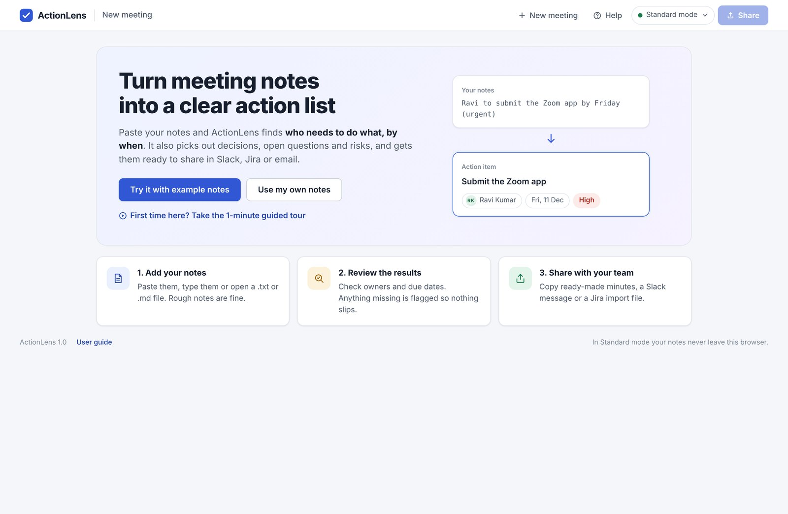
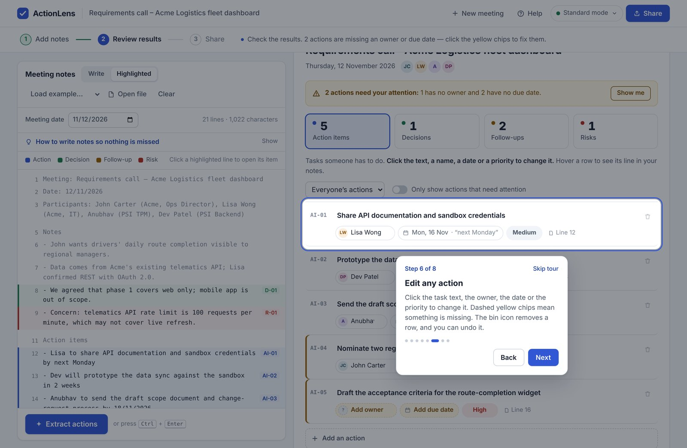
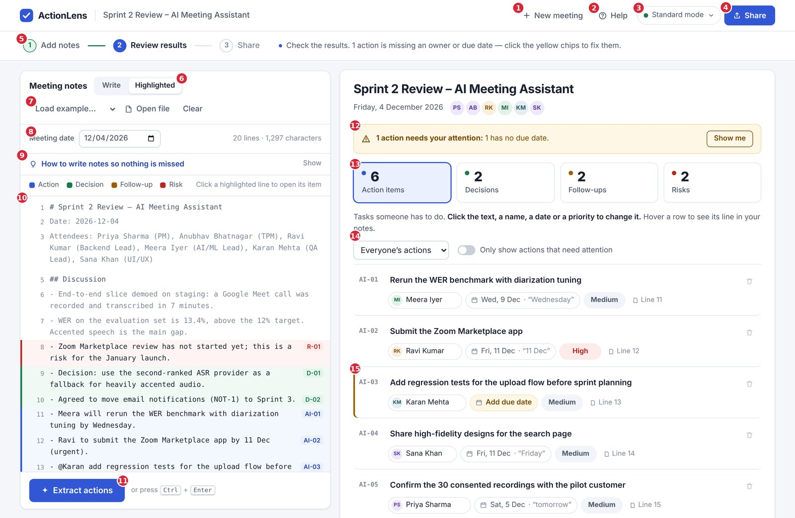
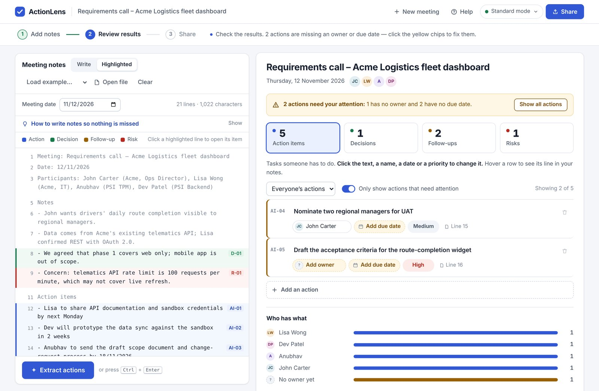
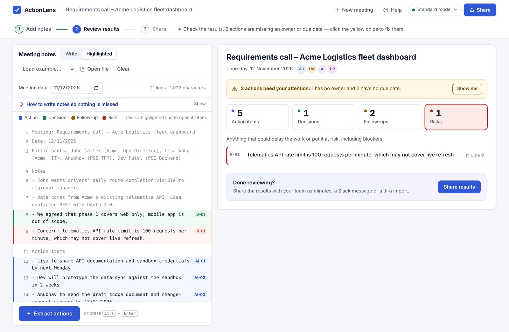
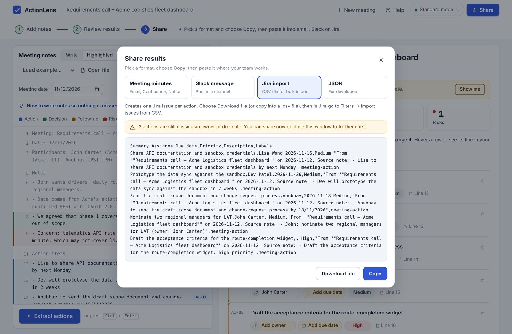
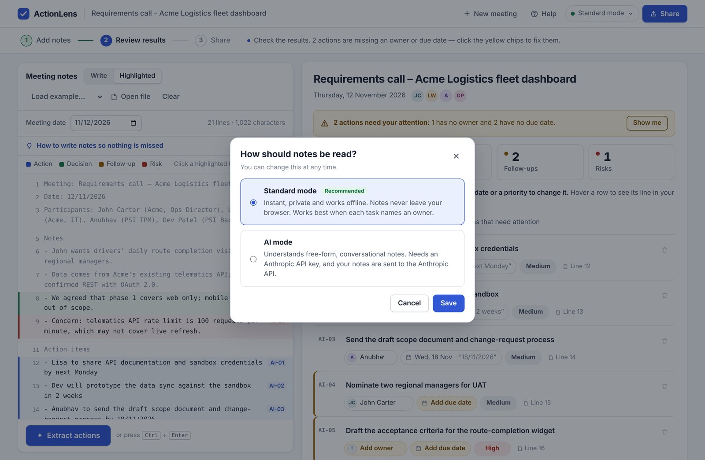
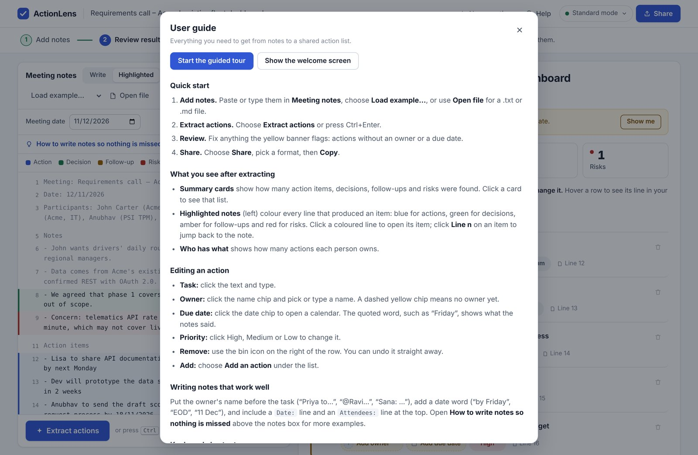

# ActionLens User Manual

Version 1.0 · November 2026

## 1. About ActionLens

ActionLens turns meeting notes into a clear action list in about a minute: who needs to do what, by when, plus the decisions, open questions and risks from the meeting.

It is built for project managers, team leads and anyone who writes up meetings. You need no training, account or installation; it runs in a web browser.

**What you get from one set of notes**

| Output | What it contains |
| --- | --- |
| Action items | Each task with its owner, due date, priority and the line in your notes it came from |
| Decisions | What the group agreed or chose |
| Follow-ups | Open questions and topics to come back to |
| Risks | Anything that could delay the work, including blockers |
| Who has what | How many actions each person owns |
| Ready-to-share text | Meeting minutes, a Slack message, a Jira import file and JSON |

**The whole process is three steps:** add your notes → review the results → share. A progress bar at the top of the screen always shows which step you are on and what to do next.

## 2. Getting Started

The first time you open ActionLens you see a welcome screen with three ways in; choose **Try it with example notes** if you are unsure.

### 2.1 Opening the app

- **Online:** open the ActionLens link you were given.
- **On your computer:** double-click the file `actionlens.html`. It opens in Chrome, Edge, Firefox or Safari and works without an internet connection.

### 2.2 The welcome screen

| Button | What it does |
| --- | --- |
| **Try it with example notes** | Loads a sample sprint-review meeting and shows the results straight away. The safest way to learn. |
| **Use my own notes** | Opens an empty notes box with writing tips shown, ready for you to paste your notes. |
| **Take the 1-minute guided tour** | Loads the example and walks you through every part of the screen in 8 short steps. |

*The welcome screen. The preview on the right shows how a line of notes becomes an action item.*

You can return to the welcome screen at any time by clicking the **ActionLens** logo, top left.

### 2.3 The guided tour

The tour dims the screen and highlights one area at a time with a short explanation.

- Choose **Next** or **Back** (or press the right and left arrow keys) to move between steps.
- Choose **Skip tour** or press **Esc** to leave at any time.
- To replay it later, open **Help** and choose **Start the guided tour**.

*Step 6 of the guided tour highlights an action row and explains how to edit it.*

## 3. The Screen at a Glance

The main screen has a top bar, a progress bar, your notes on the left and the results on the right; the numbers below match the red markers in the screenshot.

| # | Control | What it does |
| --- | --- | --- |
| 1 | **New meeting** | Clears the notes and results so you can start another meeting. You can undo it for a few seconds. |
| 2 | **Help** | Opens the in-app user guide, writing tips, shortcuts and the guided tour. |
| 3 | **Mode** (Standard mode / AI mode) | Chooses how your notes are read. See section 7. |
| 4 | **Share** | Opens the sharing window. Available once actions have been extracted. |
| 5 | **Progress bar** | Shows the current step (blue), finished steps (green tick) and a hint telling you what to do next. Click a step to go to it. |
| 6 | **Write / Highlighted** | Switches the notes panel between editing your notes and the highlighted view that shows where each result came from. |
| 7 | **Load example… / Open file / Clear** | Loads sample notes, opens a .txt or .md file, or empties the notes box (with undo). |
| 8 | **Meeting date** | The date of the meeting. Words like “Friday” or “tomorrow” are turned into real dates from it. |
| 9 | **How to write notes so nothing is missed** | Click to show examples of note styles ActionLens understands. |
| 10 | **Highlighted notes** | Your notes with every useful line coloured and labelled. Click a coloured line to open its item. |
| 11 | **Extract actions** | Reads your notes and produces the results. Shortcut: Ctrl + Enter. |
| 12 | **Attention banner** | Yellow when actions are missing an owner or due date; green when everything is complete. **Show me** lists only the actions to fix. |
| 13 | **Summary cards** | Number of action items, decisions, follow-ups and risks. Click a card to see that list. |
| 14 | **Filters** | Show one person’s actions, or only actions that need attention. |
| 15 | **Action row** | One task with its owner, due date, priority and source line. Everything in it can be edited. |

## 4. Step 1 – Add Your Notes

Put your meeting notes into the **Meeting notes** box on the left, in any of three ways; rough, bullet-point notes work well.

### 4.1 Ways to add notes

1. **Paste or type.** Click in the notes box (make sure **Write** is selected) and paste with Ctrl + V.
2. **Load an example.** Open **Load example…** and choose *Sprint 2 review* or *Client requirements call*. The results appear immediately.
3. **Open a file.** Choose **Open file** and pick a `.txt` or `.md` file. ActionLens reads it and extracts the actions straight away.

Your notes are saved in this browser as you type, so a refresh or accidental close does not lose them. Choose **Clear** to empty the box, or **New meeting** to clear notes and results together; both can be undone from the message at the bottom of the screen.

### 4.2 Set the meeting date

Check the **Meeting date** field. If your notes contain a line such as `Date: 2026-12-04`, the date is filled in for you. All relative dates are worked out from this date, so “by Friday” in notes from Friday 4 Dec becomes Friday 11 Dec.

### 4.3 Write notes that work well

ActionLens finds a task when a line says **who** will do it. Follow these patterns and nothing is missed:

| Write this | ActionLens understands |
| --- | --- |
| `Priya to send the deck by Friday` | Action for Priya, due Friday |
| `Ravi will fix login` · `Meera needs to rerun the test` | Action for Ravi · for Meera |
| `@Karan add regression tests` · `Sana: share designs` | Action for Karan · for Sana |
| `Book the room (owner: Priya)` | Action for Priya |
| Lines under a heading called `Action items`, or starting `Action:` / `TODO:` | Action (flagged if no owner is named) |
| `Decision: go with vendor A` · `We agreed to…` | Decision |
| `Follow up on budget` · `TBD` · a line ending in `?` | Follow-up or open question |
| `Risk: …` · `Blocker: …` · `may delay` · `at risk` | Risk or blocker |
| `urgent` · `ASAP` · `critical` · `P0` | High priority |
| `nice to have` · `P2` | Low priority |
| `Attendees: Priya Sharma (PM), Ravi Kumar` | First names are matched to full names and roles |

**Dates it understands:** today, EOD, tomorrow, a weekday (Friday = the next Friday), next Monday (Monday of the following week), end of week, next week, in 2 weeks, end of month, 11 Dec, Jan 15, 2027-01-15 and 18/01/2027 (day/month).

The same examples are always available inside the app: click **How to write notes so nothing is missed** above the notes box.

## 5. Step 2 – Extract and Review

Choose **Extract actions** (or press Ctrl + Enter); the results appear on the right, and your job is to check them and fix anything flagged in yellow.

A short message at the bottom of the screen confirms what was found, for example “Found 6 actions, 2 decisions, 2 follow-ups and 2 risks”.

### 5.1 Highlighted notes – see where each result came from

After extracting, the notes panel switches to **Highlighted**. Every line that produced a result is coloured and labelled with its ID:

| Colour | Meaning | Label |
| --- | --- | --- |
| Blue | Action item | AI-01, AI-02 … |
| Green | Decision | D-01 … |
| Amber | Follow-up | F-01 … |
| Red | Risk | R-01 … |

- **Click a coloured line** to jump to its item on the right.
- **Click “Line 12”** on any item to jump back to that line in your notes.
- **Hover over an action** to outline its line in the notes.
- To change the notes, choose **Write**, edit, then choose **Extract actions** again. If you edit without re-extracting, a yellow note “Notes changed. Extract again to update.” reminds you.

### 5.2 The attention banner

The banner above the summary cards tells you whether the action list is ready to share.

- **Yellow – “2 actions need your attention”:** some actions have no owner or no due date. Choose **Show me** to list only those actions. Choose **Show all actions** to return.
- **Green – “Looks complete”:** every action has an owner and a due date.

Actions that need attention also have an amber bar on their left edge and dashed yellow chips.

*After choosing Show me: only the two actions that need fixing are listed, with dashed yellow chips for the missing owner and dates.*

### 5.3 Summary cards

The four cards show how many **Action items**, **Decisions**, **Follow-ups** and **Risks** were found. The selected card is outlined; click another card to see that list. Each list has a one-line explanation at the top.

### 5.4 Editing an action

Every part of an action row can be changed by clicking it. Changes appear instantly in everything you share.

| Part of the row | How to change it |
| --- | --- |
| **Task text** | Click the text and type. |
| **Owner** (name with initials) | Click it and choose a name from the attendee list, or type any name. A dashed yellow **Add owner** chip means nobody is assigned. |
| **Due date** | Click it to open a calendar and pick a date. The word in quotes (for example “Friday”) shows what your notes said. A dashed yellow **Add due date** chip means no date was found. |
| **Priority** | Click **High**, **Medium** or **Low** to change it. High is red, Low is green. |
| **Line 12** | Shows the line in your notes this action came from. |
| **Bin icon** (right side) | Removes the action. Choose **Undo** in the message at the bottom to bring it back. |

To add a task that was not in the notes, choose **Add an action** under the list and type it in.

### 5.5 Filtering the list

- **Everyone’s actions** – open the list and pick one person to see only their actions (or *No owner yet*).
- **Only show actions that need attention** – switch on to see only actions missing an owner or date.
- When a filter is on, “Showing 2 of 5” appears on the right.

### 5.6 Decisions, follow-ups and risks

Click the matching summary card to see each list. Every item shows its ID, text and source line; follow-ups also show a person when one is named.

### 5.7 Who has what

Below the action list, **Who has what** shows how many actions each person owns, so you can spot anyone who is overloaded. Actions without an owner are shown in amber as *No owner yet*.

## 6. Step 3 – Share

Choose **Share** (top right, or **Share results** at the bottom of the results), pick a format, then choose **Copy** and paste it where your team works.

### 6.1 Formats

| Format | Best for | What it contains |
| --- | --- | --- |
| **Meeting minutes** | Email, Confluence, Notion | Title, date, attendees, decisions, an action table (ID, action, owner, due date, priority), follow-ups and risks |
| **Slack message** | A project channel or direct message | A short summary; bold headings and bullets are kept when pasted. High-priority actions are marked. |
| **Jira import** | Creating one Jira issue per action | A CSV file with Summary, Assignee, Due date, Priority, Description and Labels columns |
| **JSON** | Developers and other tools | All results as structured data |

If any actions still lack an owner or due date, a yellow note in the window says so. You can share anyway, or close the window and fix them first.

### 6.2 Copy or download

- **Copy** puts the text on your clipboard; a message confirms it. Paste with Ctrl + V.
- **Download file** saves it as a file (`.md`, `.txt`, `.csv` or `.json`), named after the meeting.
- If your browser blocks copying, ActionLens selects the text for you – press Ctrl + C to copy it.

### 6.3 Importing actions into Jira

1. In ActionLens choose **Share → Jira import → Download file**.
2. In Jira open **Filters → Import issues from CSV** (or your project’s import option).
3. Choose the downloaded `.csv` file and select your project.
4. Check that the columns map to Summary, Assignee, Due date, Priority, Description and Labels. Set the date format to `yyyy-MM-dd`.
5. Start the import. Each action becomes one issue, labelled `meeting-action`, with the original note in its description.

Assignee names must match Jira user names; edit owners in ActionLens first if they differ.

## 7. Standard Mode and AI Mode

Standard mode is the default and suits most users; AI mode is optional and helps with conversational notes that don’t follow the patterns in section 4.3.

| | Standard mode | AI mode |
| --- | --- | --- |
| Setup | None | Your own Anthropic API key |
| Privacy | Notes never leave your browser | Notes are sent to the Anthropic API |
| Speed | Instant | A few seconds |
| Works offline | Yes | No |
| Best for | Notes that name an owner for each task | Free-form, conversational notes |

**To switch mode**

1. Click the mode button in the top bar (it shows **Standard mode** with a green dot).
2. Choose **Standard mode** or **AI mode**.
3. For AI mode, paste your Anthropic API key. The key is kept only in the open browser tab and is never saved.
4. Choose **Save**, then **Extract actions** again.

In both modes every result shows the line it came from, so you can check it.

## 8. Help, Shortcuts, Privacy and Troubleshooting

Help is always one click away under **Help** in the top bar or **User guide** at the bottom of the page.

### 8.1 In-app help

The Help window contains a quick start, an explanation of every result, editing instructions, writing tips, shortcuts and privacy notes. It also has two buttons: **Start the guided tour** and **Show the welcome screen**.

### 8.2 Keyboard shortcuts

| Keys | Action |
| --- | --- |
| Ctrl + Enter (⌘ + Enter on Mac) | Extract actions |
| Esc | Close a window or leave the tour |
| ← / → | Previous / next step in the guided tour |
| Tab / Shift + Tab | Move between fields |
| Enter on a highlighted line | Open its item |

### 8.3 Privacy and data

- In **Standard mode** everything happens in your browser; notes are never sent anywhere.
- Your current notes and your mode choice are remembered in this browser only. **Clear** or **New meeting** removes the notes.
- Your API key (AI mode only) is never saved; you enter it again after closing the tab.
- Results are not stored after you leave. Copy or download them to keep them.

### 8.4 Troubleshooting

| Problem | What to do |
| --- | --- |
| “No action items were found” | Make sure each task names a person: “Priya to…”, “@Ravi…” or “Sana: …”. Or put tasks under an `Action items` heading and assign owners afterwards. |
| An action shows **Add owner** | No name was found on that line. Click the chip and choose or type a name. |
| An action shows **Add due date** | No date word was found. Click the chip and pick a date. |
| A due date is wrong | Check the **Meeting date**. Dates like “Friday” are counted from it. Then click the date chip to correct the action. |
| A first name was not matched to a full name | Add an `Attendees:` line at the top of the notes, then extract again. |
| Results don’t match my notes | You edited the notes after extracting. Choose **Extract actions** again. |
| **Share** is greyed out | Extract actions first. |
| **Copy** doesn’t work | Your browser blocked the clipboard. The text is selected for you; press Ctrl + C. |
| AI mode shows a connection error | Use ActionLens from your own copy or website, check your API key, or switch back to Standard mode. |
| I deleted something by mistake | Choose **Undo** in the message at the bottom of the screen (shown for a few seconds). |

### 8.5 Quick reference card

1. Paste notes → check the meeting date.
2. **Extract actions** (Ctrl + Enter).
3. Fix every yellow chip (owner, due date).
4. **Share** → pick a format → **Copy** → paste.
